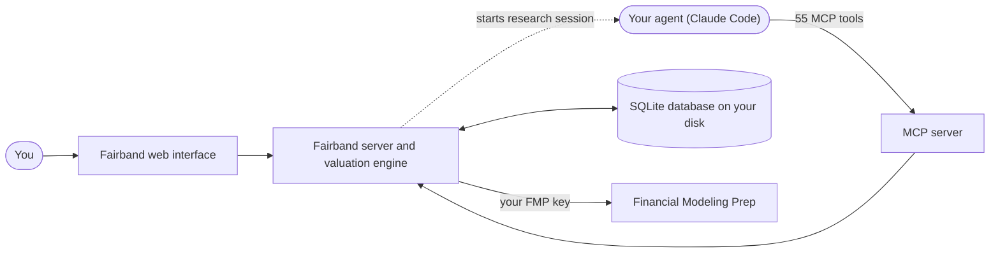
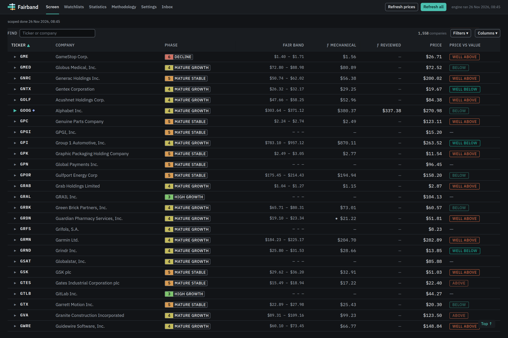

# Fairband

Fairband is a local equity research workbench that pairs a rule-based valuation engine with an MCP
server for your AI agents. It pulls market data from Financial Modeling Prep using your API key,
runs mechanical valuations, and gives you a single web interface to screen companies, inspect
financials, track watchlists, and read research. Your agent connects over MCP to read that same
data, challenge the model's assumptions where needed, and write full research reports back into
the workbench. It currently only supports Claude Code.


## Architecture



Fairband is made up of four parts:

- **Valuation engine:** Deterministic and rule-based. It sorts each company into one of six
  lifecycle phases, pairs it with a moat class (Wide, Narrow, or None), and values it under that
  phase's rules. See [docs/method-overview.md](docs/method-overview.md) for a short overview of
  the method.
- **SQLite database:** A single database file on your disk storing raw FMP data, valuation
  snapshots, and everything you or your agent writes.
- **Web interface:** A screener across all companies, a page for each company (overview,
  financials, estimates, investor relations, and research), plus pages for watchlists,
  methodology, settings, and the agent inbox.
- **MCP server:** Exposes 55 tools so your agent can query stored data, request additional data
  from FMP through the server, and save notes, findings, moat classes, updated valuations, and
  full reports.

## Screenshots

### Screener
Every company in one table, showing lifecycle phase, fair value band, mechanical and reviewed
valuations, and where the price sits relative to value.



### Company overview
Company profile, mechanical and reviewed valuations (buy, fair, and trim levels), your agent's
stance, price and volume chart, and key statistics.


### Financials
Annual and quarterly income statement, balance sheet, cash flow, segments, and ratios, with
clickable rows you can plot on the chart.


### Research reports
Agent-written reports with a section outline, cited numbers (underlined figures link back to
stored data), and inline charts.


## Research workflow

1. Click **Request research** on a company page. Fairband creates a work item in the inbox and can
   automatically open a terminal running Claude Code on it.
2. The agent claims the work item and follows the research playbook, pulling the mechanical
   valuation, financials, estimates, filings, recent earnings call transcript, and news over MCP.
3. If the agent disagrees with any of the engine's inputs (or the moat class), it updates them with
   a written explanation and supporting evidence. Fairband recalculates and shows the reviewed
   valuation alongside the mechanical one.
4. The agent submits the report; Fairband validates its citations and saves it.
5. The report appears in the company's **Research** tab along with its expiration date.

## Quickstart

Requirements: Python 3.13+, [uv](https://docs.astral.sh/uv/), and a Financial Modeling Prep API
key. I run Fairband on Linux under WSL with FMP's Ultimate plan; other systems and lower FMP
tiers haven't been tested.

1. Clone the repo and install dependencies:

   ```bash
   git clone https://github.com/kabanami/fairband.git
   cd fairband
   uv sync
   ```

2. Add your FMP API key to `~/.config/fairband/keys.toml` (outside the repo):

   ```toml
   [keys]
   fmp = "your-fmp-key"
   ```

3. Start the server, then open http://127.0.0.1:8470:

   ```bash
   uv run fairband serve
   ```

4. Click **Refresh all** in the UI. The first refresh pulls data for every company from FMP, so
   it takes a while and the database in `~/.local/share/fairband` will grow to several gigabytes.

5. Register the MCP server and link the research playbook in Claude Code (replace `<repo>` with
   the absolute path to your clone):

   ```bash
   claude mcp add --scope user fairband -- uv run --directory <repo> fairband mcp
   ln -s <repo>/playbook/fairband-research ~/.claude/skills/fairband-research
   ```

See [docs/agents.md](docs/agents.md) for configuring automatic terminal launching from the UI,
agent identity, and connecting other MCP hosts.

## The MCP tools

The server is `fairband mcp`, a stdio server that the agent's host starts. It calls the Fairband
server on 127.0.0.1 and holds no database and no key. Its 55 tools are of three kinds:

- **26 read the store:** the screen, a company's valuation, its statements, quarters, estimates,
  prices, multiples and peers, the research on file, the policy and the method.
- **9 read a vendor:** transcripts, news, segments, insider trades, filings and more, all from
  FMP. The server fetches each with its own key and stores the answer, so a report can refer to
  it. A company's list of earnings calls and its filings of the past year may be answered from
  the copy a refresh stored.
- **20 write:** the agent's identity, the work inbox, notes, findings, guidance records, the moat
  class, changes to inputs, a secondary valuation, reports, kill criteria and refreshes.

An agent's first call is `identify`, with the model it runs as. Fairband records every write
under that name. The full list is in
[the playbook's tools reference](playbook/fairband-research/reference/tools.md), and the playbook
itself, a skill that takes an agent through a report step by step, is in
[playbook/fairband-research](playbook/fairband-research/).

## How it was built

- The first commit is from 31 October 2026. Eighteen days later the repository held more than
  660 commits and 4,580 tests.
- Each larger feature has a written design and a plan, was built task by task with a review of
  each task, and had a review of the whole branch before its merge. The 19 designs are in
  [docs/superpowers/specs](docs/superpowers/specs/) and the 28 plans in
  [docs/superpowers/plans](docs/superpowers/plans/).
- Nearly every design ends with a decision log: what was ruled, by whom, and what went wrong on
  the way.
- [CLAUDE.md](CLAUDE.md) holds the standing instructions the agents work under, and
  [docs/backlog.md](docs/backlog.md) the work not started.

These numbers describe speed, not correctness. The method changed many times in those weeks, and
the values moved with it.

## Smaller things worth knowing

- Every number in an agent's report carries a reference to stored data, and Fairband checks the
  references when the report is submitted.
- An agent's change to an input keeps its reason and its writer.
- A report states the tests that would prove its thesis wrong, and it expires: for a company on a
  watchlist, Fairband posts a new review when the report's validity window ends.
- A company that reports in another currency is valued in that currency, and an ADR's figures a
  share are per ADS.
- A report downloads as Markdown.
- The exact rules are in [docs/method.md](docs/method.md), and the page has a Methodology view
  with worked examples.

## Status

Fairband is a personal project. I share it as it is, with no promise of support. Issues are
welcome. For a change, please open an issue before a pull request.

It is young, its method still changes, and it has no track record. Nothing in this repository is
investment advice.

No market data comes with the repository. The screenshots show Fairband running on my own data
subscriptions; to run it you need your own key and must follow your vendor's terms.

## Licence

[Apache License 2.0](LICENSE), with the notices of the bundled software and fonts in
[NOTICE](NOTICE). The licence does not grant the use of the name Fairband or of its mark (its
section 6).

## Author

Khalid Abanami, on [LinkedIn](https://www.linkedin.com/in/khalid-abanami-a034108/).
