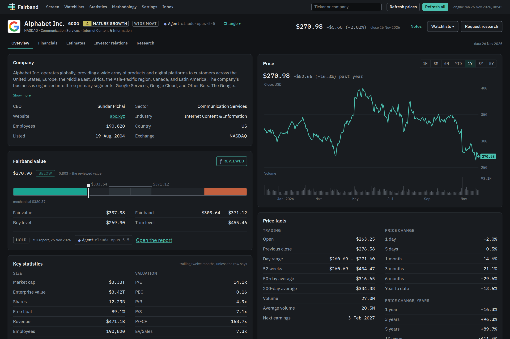
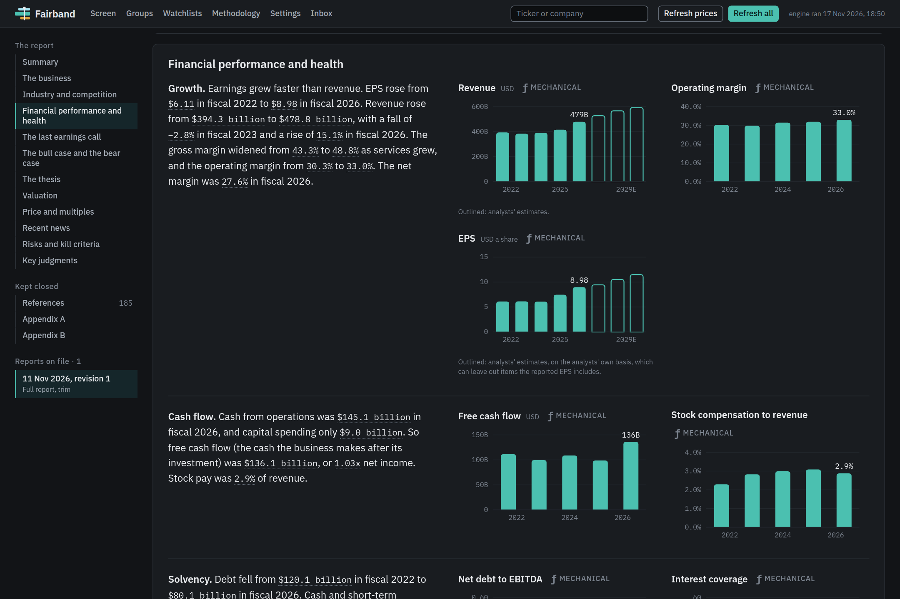

# Fairband

Fairband is a local equity research workbench that pairs a rule-based valuation engine with an MCP
server for your AI agents. It pulls market data from Financial Modeling Prep (FMP) using your API
key, runs mechanical valuations, and gives you a single web interface to screen companies, inspect
financials, track watchlists, and read research. Your agent connects over MCP to read that same
data, challenge the model's assumptions where needed, and write full research reports back into
the workbench. It currently only supports Claude Code.

https://github.com/user-attachments/assets/a699bbce-f1f8-4c02-8897-4e1abf358f6f

A research request on Alphabet, from the Screen to the finished report. The agent's 17-minute run
is shown at high speed.

## Architecture


Fairband is made up of four parts:

- **Valuation engine:** Deterministic and rule-based. It sorts each company into one of six
  lifecycle phases, pairs it with a moat class (Wide, Narrow, or None), and values it under that
  phase's rules. See [docs/method-overview.md](docs/method-overview.md) for a short overview of
  the method.
- **SQLite database:** A single database file on your disk storing raw FMP data, valuation
  snapshots, and everything you or your agent writes.
- **Web interface:** A screener across all companies, a page for each company (overview,
  financials, estimates, investor relations, and research), plus pages for watchlists,
  methodology, settings, and the inbox.
- **MCP server:** Exposes 56 tools so your agent can query stored data, request additional data
  from FMP through the server, and save notes, findings, moat classes, updated valuations, and
  full reports.

## Screenshots

### Screener
Every company in one table, showing lifecycle phase, fair value band, mechanical and reviewed
valuations, and where the price sits relative to value.


### Company overview
Company profile, mechanical and reviewed valuations (buy, fair, and trim levels), your agent's
stance, price and volume chart, and key statistics.



### Financials
Annual and quarterly income statement, balance sheet, cash flow, segments, and ratios, with
clickable rows you can plot on the chart.


### Research reports
Agent-written reports with a section outline, cited numbers (underlined figures link back to
stored data), and inline charts.




## Research workflow

1. Click **Request research** on a company page. Fairband creates a work item in the inbox and can
   automatically open a terminal running Claude Code on it.
2. The agent claims the work item and follows the research playbook, pulling the mechanical
   valuation, financials, estimates, filings, recent earnings call transcript, and news over MCP.
3. If the agent disagrees with any of the engine's inputs (or the moat class), it updates them with
   a written explanation and supporting evidence. Fairband recalculates and shows the reviewed
   valuation alongside the mechanical one.
4. The agent submits the report; Fairband validates its citations and saves it.
5. The report appears in the company's **Research** tab along with its expiration date.
6. The **Messages** tab of the Inbox shows a message for the finished report, and the browser
   shows a notification.

To turn the notifications on, click **Turn on notifications** once on the Messages tab. They need
a Fairband tab open in the browser, which can stay in the background. Chrome's Memory Saver can
put a tab that has been in the background for a long time to sleep, and a sleeping tab shows no
notification. To prevent this, add the address (`127.0.0.1:8470`) in Chrome under Settings,
Performance, **Always keep these sites active**.

## Quickstart

Requirements: Python 3.13+, [uv](https://docs.astral.sh/uv/), and an FMP API key. I run Fairband
on Linux under WSL, and it currently supports FMP's Ultimate and Premium plans only.

1. Clone the repo and install dependencies:

   ```bash
   git clone https://github.com/kabanami/fairband.git
   cd fairband
   uv sync
   ```

2. Add your FMP API key to `~/.config/fairband/keys.toml` (outside the repo):

   ```toml
   [keys]
   fmp = "your-fmp-key"
   ```

   ```toml
   [fmp]
   plan = "premium"  # your FMP plan: "premium" or "ultimate" (the default)
   ```

3. Start the server, then open http://127.0.0.1:8470:

   ```bash
   uv run fairband serve
   ```

4. Click **Refresh all** in the UI. The first refresh pulls data for every company from FMP, so
   it takes a while and the database in `~/.local/share/fairband` will grow to several gigabytes.

5. Register the MCP server and link the research playbook in Claude Code (replace `<repo>` with
   the absolute path to your clone):

   ```bash
   claude mcp add --scope user fairband -- uv run --directory <repo> fairband mcp
   ln -s <repo>/playbook/fairband-research ~/.claude/skills/fairband-research
   ```

See [docs/agents.md](docs/agents.md) for configuring automatic terminal launching from the UI,
agent identity, and connecting other MCP hosts.

## MCP server and tools

`fairband mcp` runs as a stdio MCP server spawned by your agent host. It's a thin client over
the local HTTP API (`127.0.0.1:8470`), so it doesn't access the database or your FMP key
directly.

The 56 tools fall into three groups:

- **Stored data reads (26):** Query the screener, valuations, financial statements, quarterly
  figures, estimates, price history, multiples, peers, existing research, policy settings, and
  methodology docs.
- **Vendor reads (9):** Fetch transcripts, news, segments, insider trades, and filings from FMP
  through the local server. The data is saved to SQLite so reports can cite it, and anything
  already cached by a recent refresh is reused when available.
- **Writes (21):** Register agent identity, manage inbox work items, save notes, findings,
  guidance, moat classes, updated valuations, kill criteria, and full reports, or trigger
  refreshes.

Before making any writes, an agent has to call `identify` with its model name; every write is
tagged with that identity. See [tools.md](playbook/fairband-research/reference/tools.md) for the
full tool reference and [playbook/fairband-research](playbook/fairband-research/) for the
step-by-step research playbook.

## Valuation methodology

See [docs/method-overview.md](docs/method-overview.md) for a short overview, or
[docs/method.md](docs/method.md) for the full valuation rules. The web UI also includes a
**Methodology** view with worked examples.

## Status

Fairband is a personal project shared as-is, with no guarantee of support. Issues are welcome; if
you want to submit a pull request, please open an issue first.

The project is still early and the valuation rules change regularly. Nothing in this repository
is investment advice.

No market data is included in this repository. The screenshots were taken using my own FMP
subscription; to run Fairband yourself, you'll need your own API key and must follow your data
vendor's terms.

## License

Licensed under the [Apache License 2.0](LICENSE). Third-party software and font notices are in
[NOTICE](NOTICE). Per Section 6 of the license, this does not grant rights to use the Fairband
name or logo.

## Author

Khalid Abanami ([LinkedIn](https://www.linkedin.com/in/khalid-abanami-a034108/))
