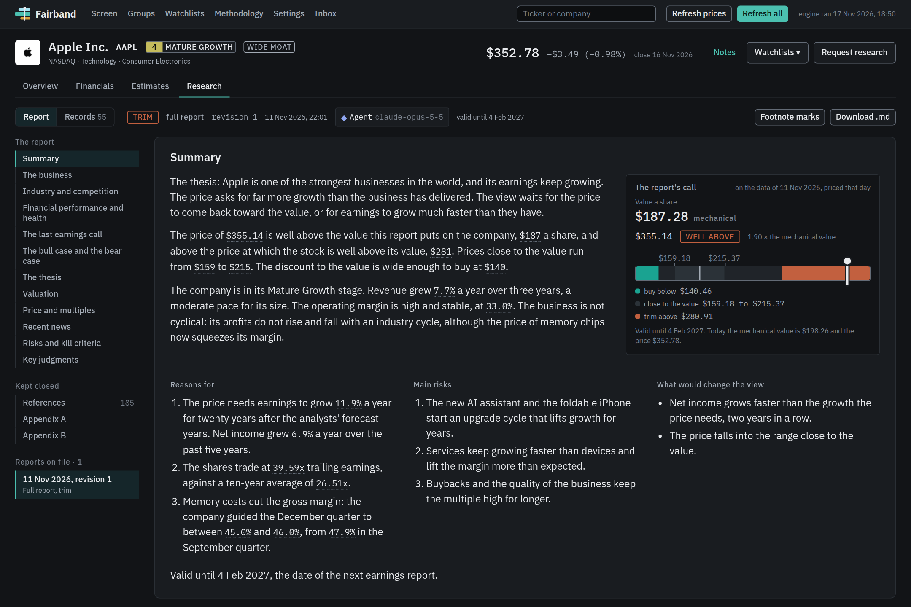
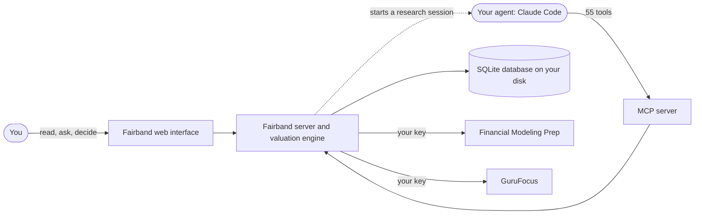
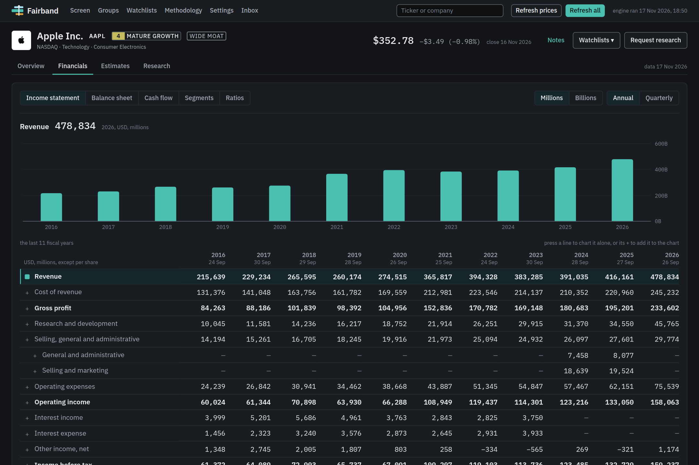

# Fairband

Fairband is a local equity research workbench for you and your AI agents. It values companies,
and your own agents read and write to the workbench through its MCP server, up to full research
reports.



It runs on your own machine, with your own data keys. It is currently designed for Claude Code,
with Codex coming soon.

## How the parts fit



**You bring**

- **An agent.** Claude Code today. It connects to the MCP server and follows a playbook that is
  in this repository.
- **Two data keys.** One for Financial Modeling Prep (statements, estimates, prices, filings,
  transcripts and news) and one for GuruFocus (the moat score and a few figures). They stay in a
  file outside the repository.
- **Your judgment.** You set the policy on the Settings page, you ask for the research, and you
  decide what to do with it.

**Fairband gives**

- **A valuation engine.** It is rule-based and holds no AI model. It sorts each company into one
  of six phases, values it by that phase's rules, and refuses to value it where the rules do not
  apply. See [a short overview of the method](docs/method-overview.md).
- **A store.** One SQLite database on your disk, with every vendor answer, every valuation and
  every record an agent writes.
- **Pages.** A screen of all companies; a page for each company with its overview, financials,
  estimates, investor relations and research; and pages for groups, watchlists, the method, the
  settings and the agents' inbox.
- **An MCP server.** 55 tools through which an agent reads the store, asks the vendors for more,
  and writes notes, findings, changes to inputs and reports.

## The pages

**The screen.** Every company in one table, with its phase, its fair value and how its price
compares.


**A company's overview.** What the company does, its fair value, its price and its key
statistics.


**A company's financials.** The income statement, the balance sheet, the cash flow, the segments
and the ratios, by year or by quarter.



**A company's research.** The report your agent wrote, with its charts.


## How a research report gets made

1. You press **Request research** on a company's page. Fairband posts a work item, and it can
   open a terminal window in which Claude Code starts on that item.
2. The agent claims the item and follows the playbook. It reads the company through the tools:
   the valuation, the statements, the estimates, the filings, the last earnings call, the news.
3. Where it disagrees with an input the engine set by rule, it changes that input and gives its
   reason. Fairband then shows a reviewed value beside the mechanical value.
4. The agent submits the report. Fairband checks it and stores it.
5. You read it in the company's Research tab, with the date until which it stays valid.

## Quickstart

You need Python 3.13 or later, [uv](https://docs.astral.sh/uv/), a Financial Modeling Prep key
and a GuruFocus key. I run Fairband on Linux under WSL, on FMP's Ultimate plan. Other systems and
smaller plans are untested.

1. **Install.**

   ```
   git clone https://github.com/kabanami/fairband.git
   cd fairband
   uv sync
   ```

2. **Add your keys** in `~/.config/fairband/keys.toml`. Never commit this file.

   ```toml
   [keys]
   fmp = "your FMP key"
   gurufocus = "your GuruFocus key"
   ```

3. **Start the server**, then open http://127.0.0.1:8470.

   ```
   uv run fairband serve
   ```

4. **Press Refresh all.** The first refresh reads every company of the universe from the
   vendors, so it takes a while, and the database in `~/.local/share/fairband` grows to several
   gigabytes.

5. **Connect Claude Code.** `<repo>` is the absolute path of this directory.

   ```
   claude mcp add --scope user fairband -- uv run --directory <repo> fairband mcp
   ln -s <repo>/playbook/fairband-research ~/.claude/skills/fairband-research
   ```

[Agents](docs/agents.md) has the rest: the other hosts, the agent's identity, and how the page
opens Claude Code for you.

## The MCP tools

The server is `fairband mcp`, a stdio server that the agent's host starts. It calls the Fairband
server on 127.0.0.1 and holds no database and no key. Its 55 tools are of three kinds:

- **26 read the store:** the screen, a company's valuation, its statements, quarters, estimates,
  prices, multiples and peers, the research on file, the policy and the method.
- **10 read a vendor:** transcripts, news, segments, insider trades, filings and more. The server
  fetches each with its own key and stores the answer, so a report can refer to it. A company's
  list of earnings calls and its filings of the past year may be answered from the copy a
  refresh stored.
- **19 write:** the agent's identity, the work inbox, notes, findings, guidance records, changes
  to inputs, a secondary valuation, reports, kill criteria and refreshes.

An agent's first call is `identify`, with the model it runs as. Fairband records every write
under that name. The full list is in
[the playbook's tools reference](playbook/fairband-research/reference/tools.md), and the playbook
itself, a skill that takes an agent through a report step by step, is in
[playbook/fairband-research](playbook/fairband-research/).

## How it was built

- The first commit is from 31 October 2026. Eighteen days later the repository held more than
  660 commits and 4,580 tests.
- Each larger feature has a written design and a plan, was built task by task with a review of
  each task, and had a review of the whole branch before its merge. The 19 designs are in
  [docs/superpowers/specs](docs/superpowers/specs/) and the 28 plans in
  [docs/superpowers/plans](docs/superpowers/plans/).
- Nearly every design ends with a decision log: what was ruled, by whom, and what went wrong on
  the way.
- [CLAUDE.md](CLAUDE.md) holds the standing instructions the agents work under, and
  [docs/backlog.md](docs/backlog.md) the work not started.

These numbers describe speed, not correctness. The method changed many times in those weeks, and
the values moved with it.

## Smaller things worth knowing

- Every number in an agent's report carries a reference to stored data, and Fairband checks the
  references when the report is submitted.
- An agent's change to an input keeps its reason and its writer.
- A report states the tests that would prove its thesis wrong, and it expires: for a company on a
  watchlist, Fairband posts a new review when the report's validity window ends.
- A company that reports in another currency is valued in that currency, and an ADR's figures a
  share are per ADS.
- A report downloads as Markdown.
- The exact rules are in [docs/method.md](docs/method.md), and the page has a Methodology view
  with worked examples.

## Status

Fairband is a personal project. I share it as it is, with no promise of support. Issues are
welcome. For a change, please open an issue before a pull request.

It is young, its method still changes, and it has no track record. Nothing in this repository is
investment advice.

No market data comes with the repository. The screenshots show Fairband running on my own data
subscriptions; to run it you need your own keys and must follow your vendors' terms.

## Licence

[Apache License 2.0](LICENSE), with the notices of the bundled software and fonts in
[NOTICE](NOTICE). The licence does not grant the use of the name Fairband or of its mark (its
section 6).

## Author

Khalid Abanami, on [LinkedIn](https://www.linkedin.com/in/khalid-abanami-a034108/).
